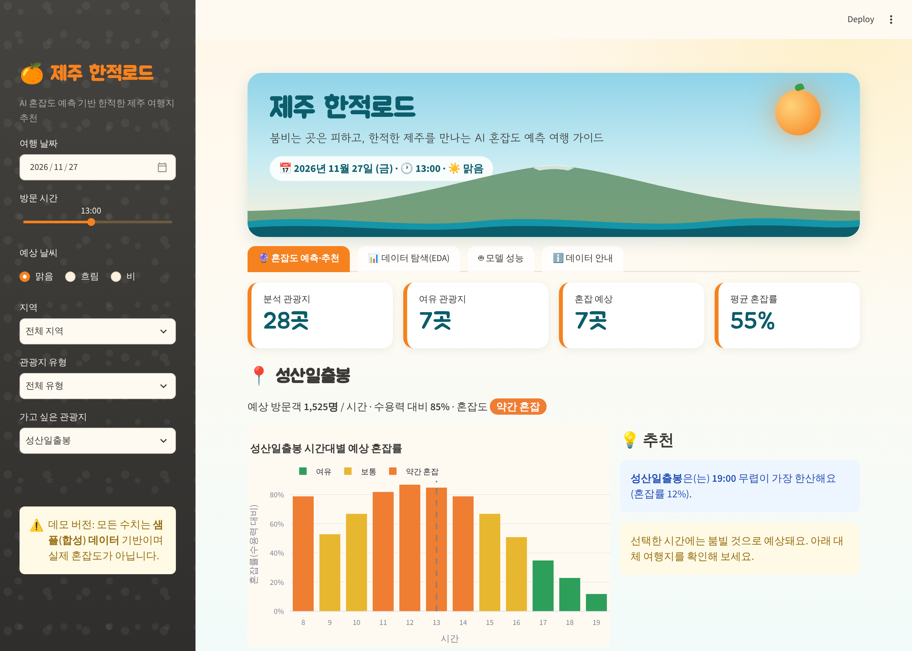

# 🍊 제주 한적로드

**AI 혼잡도 예측 기반 한적한 제주 여행지 추천 (데모 버전)**

여행 날짜·시간·날씨를 고르면 제주 주요 관광지 28곳의 시간대별 혼잡도를 예측하고,
붐비는 곳 대신 **가까우면서 한적한 대체 여행지**와 **가장 한산한 방문 시간**을 추천하는 Streamlit 대시보드입니다.

> ⚠️ **데모 안내**: 이 저장소의 방문객 데이터는 실제 측정값이 아닌 **샘플(합성) 데이터**입니다.
> 관광지 이름·위치는 실제이지만, 방문객 수는 성수기·주말·공휴일·시간대·날씨 패턴을 반영해 생성한 가상의 값입니다.
> 실데이터 연동 방법은 아래 [실데이터로 바꾸기](#실데이터로-바꾸기)를 참고하세요.



📄 프로젝트 설명서(PDF): [docs/project_description.pdf](docs/project_description.pdf)

## 프로젝트 흐름

`주제 선정 → 데이터 수집 → 데이터 분석(EDA) → 혼잡도 예측 → Streamlit 대시보드`

| 단계 | 내용 |
|---|---|
| 문제 | 제주 인기 관광지는 특정 시간·시즌에 몰린다. 언제·어디가 한적할지 미리 알 수 있을까? |
| 데이터 | 관광지 28곳 × 2025년 365일 × 08~19시 = 122,640행 (샘플) |
| 분석 | 월별·요일·공휴일·시간대·날씨(실내/실외)별 방문 패턴 |
| 예측 | 시간당 방문객 수 회귀 → 수용력 대비 비율 → 혼잡도 4단계 (여유/보통/약간 혼잡/혼잡) |
| 결과물 | 예측 + 대체 여행지 추천 + 지도 + EDA + 모델 성능을 한 화면에 제공 |

## 주요 기능

- 🔮 **혼잡도 예측**: 날짜·시간·날씨 선택 → 관광지별 예상 방문객과 혼잡도
- ⏰ **최적 방문 시간**: 선택한 관광지의 시간대별 혼잡률 그래프와 가장 한산한 시간 안내
- 🌿 **대체 여행지 추천**: 혼잡도가 더 낮고, 가깝고, 같은 유형인 관광지 TOP 5
- 🍊 **제주 테마 디자인**: 감귤·바다·현무암 돌담 색감, 한라산·파도 배너 (`src/theme.py`)
- 🗺️ **혼잡도 지도**: 관광지 위치를 혼잡도 색상으로 표시 (OpenStreetMap)
- 📊 **EDA 탭**: 성수기, 요일·공휴일, 유형×시간대 히트맵, 날씨 영향 등
- 🤖 **모델 성능 탭**: 3개 모델 비교(MAE·R²·혼잡도 단계 정확도), 실제값 vs 예측값

## 모델

| 모델 | MAE(명) | R² | 혼잡도 단계 정확도 |
|---|---|---|---|
| **HistGradientBoosting** | **70.2** | **0.947** | **0.853** |
| RandomForest | 81.1 | 0.926 | 0.822 |
| LinearRegression | 273.9 | 0.351 | 0.504 |

- Feature: 관광지, 지역, 유형, 날씨, 월, 요일, 시간, 주말 여부, 공휴일 여부
- Label: 시간당 방문객 수 (`visitors`)
- 혼잡도 단계: 수용력 대비 40% 미만 여유 / 70% 미만 보통 / 100% 미만 약간 혼잡 / 그 이상 혼잡
- 합성 데이터라 성능이 높게 나옵니다. 실데이터에서는 낮아질 수 있습니다.

## 실행 방법

```bash
git clone https://github.com/yehwan-ahh/jeju-congestion-trip.git
cd jeju-congestion-trip
python -m venv .venv && source .venv/bin/activate   # Windows: .venv\Scripts\activate
pip install -r requirements.txt
streamlit run app.py
```

브라우저에서 http://localhost:8501 이 열립니다. 첫 실행 시 모델 학습에 10초 정도 걸립니다.

부가 스크립트:

```bash
python -m src.generate_data   # 샘플 데이터 다시 생성
python -m src.model           # 모델 비교 결과 출력 + models/ 에 저장
```

## 폴더 구조

```
jeju-congestion-trip/
├── app.py                         # Streamlit 대시보드
├── src/
│   ├── spots.py                   # 관광지 목록·좌표·수용력, 공휴일, 혼잡도 기준
│   ├── generate_data.py           # 샘플(합성) 데이터 생성
│   ├── model.py                   # 학습·평가·예측
├── data/jeju_congestion_sample.csv.gz
├── docs/                          # 스크린샷
├── .streamlit/                    # 테마, secrets 예시
└── requirements.txt
```

## Streamlit Community Cloud 배포

1. 이 저장소를 GitHub에 Public으로 올립니다.
2. https://share.streamlit.io 에 GitHub 계정으로 로그인합니다.
3. **Create app → Deploy a public app from GitHub** 선택
4. Repository `yehwan-ahh/jeju-congestion-trip`, Branch `main`, Main file path `app.py` 입력
5. (실데이터 버전) **Advanced settings → Secrets** 에 `.streamlit/secrets.toml.example` 형식으로 API 키 입력
6. **Deploy** 클릭 → 몇 분 뒤 `https://<앱이름>.streamlit.app` 주소가 생성됩니다.

## 실데이터로 바꾸기

| 데이터 | 출처 | 용도 | 비고 |
|---|---|---|---|
| 관광지 혼잡도·방문객 | 제주데이터허브 (jejudatahub.net) | 학습 라벨 | 회원가입 후 API 키 발급 |
| 관광지 집중률 예측 | 한국관광 데이터랩 (datalab.visitkorea.or.kr), 공공데이터포털 '한국관광공사_관광지 집중률 방문자 추이 예측 정보' | 라벨/검증 | 공공데이터포털 서비스키 |
| 관광지 정보·좌표 | 한국관광공사 TourAPI (공공데이터포털) | 관광지 목록 확장 | 공공데이터포털 서비스키 |
| 날씨 | 기상청 단기예보·ASOS 관측 (공공데이터포털) | 날씨 Feature | 공공데이터포털 서비스키 |
| 공휴일 | 한국천문연구원 특일 정보 (공공데이터포털) | 공휴일 Feature | 공공데이터포털 서비스키 |

1. 위 사이트에서 API 키를 발급받아 `.streamlit/secrets.toml` 에 저장합니다 (커밋 금지, `.gitignore` 처리됨).
2. 수집 스크립트로 `data/jeju_congestion_sample.csv.gz` 와 **같은 컬럼 구조**
   (`date, month, weekday, hour, is_weekend, is_holiday, weather, spot, area, category, visitors, capacity`)의 CSV를 만듭니다.
3. 관광지 목록은 `src/spots.py`, 데이터 경로는 `src/model.py` 의 `DATA` 를 바꾸면 앱은 그대로 동작합니다.

## 향후 개선

- 실데이터 연동 및 일 단위 → 시간 단위 보정
- 날씨 예보 API 자동 연동 (날씨 직접 선택 대신)
- 딥러닝(LSTM 등) 시계열 모델과 성능 비교
- 숙박·맛집 평점 데이터와 결합한 하루 코스 추천
- 사용자 위치 기반 동선 최적화
